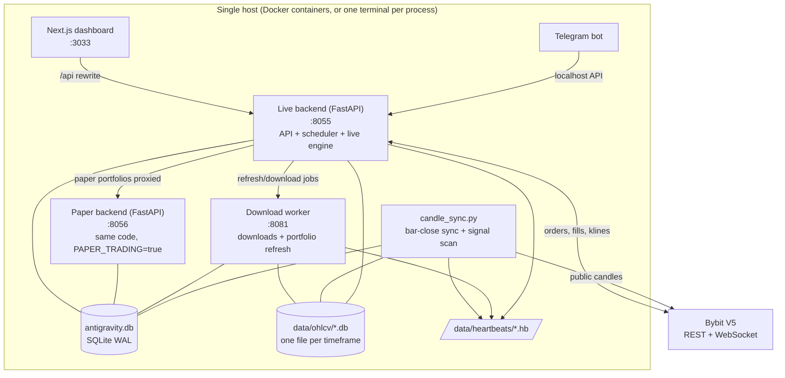
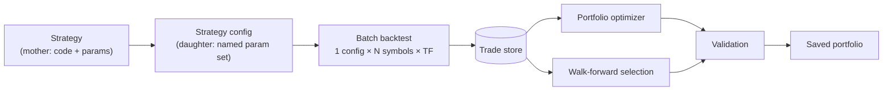
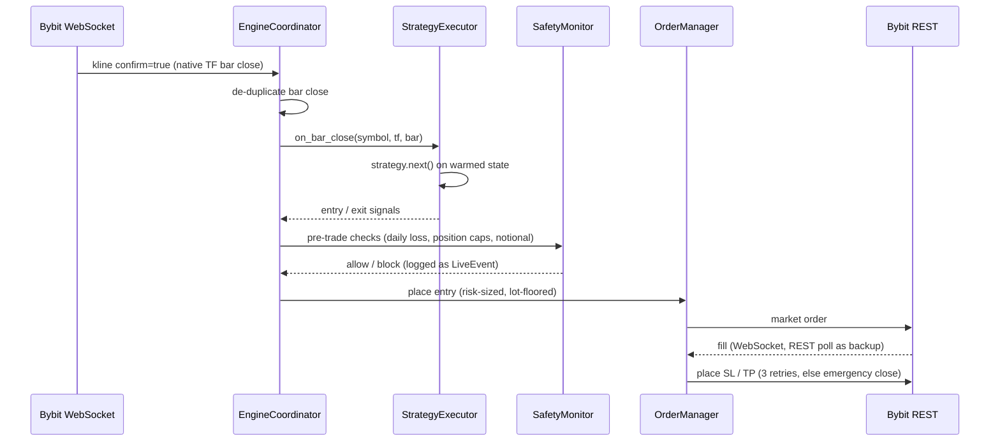

# The War Room — Architecture

This document explains how the platform is put together, why it is shaped that way, and where its edges are. It is written for an engineer reading the code for the first time.

**Contents**
1. [Goals and non-goals](#1-goals-and-non-goals)
2. [Process topology](#2-process-topology)
3. [Storage](#3-storage)
4. [The research pipeline](#4-the-research-pipeline)
5. [Validation: trying to prove a result wrong](#5-validation-trying-to-prove-a-result-wrong)
6. [The live loop (nightly pipeline)](#6-the-live-loop-nightly-pipeline)
7. [Execution: paper and live](#7-execution-paper-and-live)
8. [Observability](#8-observability)
9. [Testing strategy](#9-testing-strategy)
10. [Design decisions and trade-offs](#10-design-decisions-and-trade-offs)
11. [Known limitations](#known-limitations)

---

## 1. Goals and non-goals

**Goals**
- Take a strategy from code to exchange orders inside one system, so the backtest and the live engine run the *same* strategy object and the same order semantics.
- Make overfitting expensive. Every selection step has an out-of-sample check, and every incremental shortcut has a from-scratch audit.
- Run unattended on a single home server, survive restarts, and say loudly when something stops.

**Non-goals**
- Multi-user or multi-machine scale. One operator, one SQLite file per concern.
- Tick-level or order-book simulation. The engine works on OHLC bars.
- Being a strategy. The platform evaluates strategies; it does not ship one with an edge.

---

## 2. Process topology

**Why several processes instead of one.** Long downloads, nightly refreshes and order handling must not block each other. The download worker is a separate FastAPI app, so a 20-minute portfolio refresh never stalls an API request or a fill callback. `candle_sync.py` is separate so candle freshness does not depend on the API being healthy. The paper backend is the same code with a different flag, so paper trading exercises the real order-management path. All of them coordinate through SQLite in WAL mode: many readers, one writer at a time, no server process.

**Timezones.** Candles are stored in UTC. Before backtesting they are converted to New York time because strategies were written against TradingView/PineScript semantics (`hour`, `dayofweek` are exchange-display time). Trade timestamps in the trade store are NYT-naive; session filters compare NYT hours. Nightly jobs are scheduled in NYT.

---

## 3. Storage

| Store | Contents | Notes |
|---|---|---|
| `data/antigravity.db` | 32 tables: strategies and parameter sets, backtest runs and ~3M trades, batch runs, portfolios and baskets, walk-forward runs, live orders, positions and trades, daily P&L, journal, audit events, Kelly allocations, rebalance proposals, parity reports | SQLAlchemy 2 ORM. Migrations are idempotent scripts run at startup. Foreign keys cascade on delete. |
| `data/ohlcv/ohlcv_<tf>.db` | Candles (the 33rd table), one SQLite file per timeframe | Split from the main DB so candle upserts never contend with trade-store writes. |
| `data/heartbeats/*.hb` | One ISO timestamp per long-running component | File mtime is the heartbeat; works across processes without a shared DB row. |
| `data/live_engine_state/`, `data/paper_refresh_state/` | Crash-safe engine state and incremental-refresh caches | Runtime artefacts, never committed. |

**Reading the trade store at scale.** Loading 3M trades through the ORM is too slow for research work, so `analysis/batch_selection.py:load_trades_lightweight` reads only the seven columns research needs into named tuples and applies each batch's P&L multiplier on the way in.

---

## 4. The research pipeline

### 4.1 Strategies

A strategy is a Python class deriving from `backtester/base_strategy.py:BaseStrategy`. The API deliberately mirrors PineScript: `init()` builds indicator series, and `next()` runs once per bar and calls `entry(...)` and `exit(...)` with `stop`, `limit`, `trail_points` and `trail_offset`. Indicators live in `backtester/indicators.py` (`ta.*`). ATR uses Wilder's RMA so values match TradingView after regime shifts.

The **mother/daughter** model separates code from parameters. A mother holds the source and its parameter definitions; each daughter is a named parameter set. A batch run is always one daughter over many symbols.

Strategy source is stored in the database and executed by `utils/safe_exec.py`. That executor rejects blocked imports at the AST level, swaps in a restricted `__import__`, removes `exec`, `eval`, `open` and similar builtins, and caches compiled classes by source hash.

**From PineScript to Python with an LLM.** The platform began with a hand-written PineScript→Python transpiler. It was retired in March 2026; a small shim package keeps old stored strategies importable. Its replacement is `frontend/src/lib/claude-prompt.ts`, which wraps a strategy's PineScript in a ~600-line translation contract for an LLM. The contract tells the model to ask clarifying questions before writing code. It spells out the `BaseStrategy` API and execution model (next-bar fills, partial exits, multi-timeframe access), how to size warm-up so higher-timeframe indicators have converged, and that strategy state must be plain JSON-serialisable types (the snapshot/resume machinery in §4.2 depends on it). Optionally it adds TradingView's exact smoothing method for every indicator family. The generated class is pasted back, stored as a strategy, and judged by backtest like any other.

### 4.2 The backtest engine

`backtester/engine.py` runs one strategy over one symbol, one bar at a time. On each bar, in order:

1. Fill **pending entries** queued on the previous bar at this bar's **open**. Optionally, `process_orders_on_close` fills them at the signal bar's close instead.
2. Check **persistent exit orders** against this bar's range. If the open already gapped through a stop or limit, it fills at the open. Otherwise the **stop is checked before the target** (the conservative assumption when both were touched), then the trailing stop.
3. Update per-position extremes for MAE/MFE.
4. Call `strategy.next()`.
5. If engine-level risk sizing is on, re-size the just-registered entries from the stop distance.
6. Append mark-to-market equity.

Costs modelled: commission (default 0.055%, Bybit taker), slippage (percent, pips or fraction of risk), half-spread on each side, and daily funding charged at close. Sizing modes: fixed quantity, % of equity at risk, or fixed $ at risk, capped to available margin. There are four streak-based sizing modes (martingale, anti-martingale and their inverses); the streak can be scoped per asset, per batch or per portfolio. Bybit lot size and min/max quantity can be enforced.

**State capture.** At the last bar, *before* force-closing open positions, the engine serialises every public strategy attribute (indicator buffers, counters, persistent variables) and every open position with **all** of its exit orders. A later run can take `inject_strategy_state` and `inject_positions` and continue as if it had never stopped. This one mechanism powers the nightly incremental refresh, the live scanner's warm start, and the paper-refresh cache.

### 4.3 Objectives and metrics

There are two scoring conventions, kept in separate modules on purpose:

| Module | Used by | Convention |
|---|---|---|
| `analysis/scoring.py` | Optimizer (22 objectives) | Lower is better (minimisation). Inputs are daily P&L series. |
| `analysis/batch_selection_scoring.py` | Batch Selection walk-forward (24 metrics) | Higher is better. Below 10 active days → `-999` (skip). Undefined ratios are capped at 10. |

The optimizer evaluates candidates two ways. A **reference path** scores each candidate with the scalar function. A **vectorised path** (`_batch_score_candidates`) scores K candidates in one NumPy pass and is used by the Settings Recommender's cross-validation sweep. A parametrised test asserts the two paths agree for every objective, including degenerate cases (never traded, never lost, no drawdown, very short series). That test found four divergences in the October 2026 audit. The worst: a never-traded candidate scored −∞, the *best* possible, on the vectorised profit-factor path.

Every Ulcer Index in the codebase goes through one helper, `scoring.ulcer_index()`. It measures drawdowns in % of a single reference scale for the whole curve. P&L curves have no capital base, so dividing by the running peak, as the textbook does, breaks when the peak is still ≤ 0: a curve whose first trade lost was scored about 100× worse than the same dollar drawdown after a win.

The KPI suite (`analysis/full_metrics.py`, 50+ values) drives the analysis pages. Ratios that become undefined with few trades are capped (10 below 10 trades, 99 above) so that a 3-trade run cannot headline the table.

### 4.4 Portfolio optimizer

Input: a matrix of daily P&L, one column per (batch, symbol, side) "asset". Output: diverse asset subsets that optimise an objective.

- **Greedy (default).** Start from the best-ranked seeds, then repeatedly add whichever asset most improves the objective. Final portfolios must differ from each other by at least one swapped asset.
- **Eight alternatives:** hierarchical risk parity, PCA factor clustering, quality-first with correlation pruning, tournament sampling, a genetic algorithm, marginal-Sharpe, an ensemble vote and a walk-forward-validated variant.
- **Beam search over batches** (`analysis/beam_optimizer.py`). L1 keeps K diverse variants per batch, L2 searches user-defined batch groups exhaustively, and L3 assembles the global portfolio. Optional "harmony" gates filter inter-batch combinations. The RNG is seeded when the combination space is sampled, so results reproduce.
- **Seeds and priors.** Seeds can be ranked by 40 metrics, including structural ones (trend efficiency, Hurst-style persistence, mean-reversion intensity, deflated Sharpe).

### 4.5 Walk-forward engines

Window generation (`analysis/wfo_window_gen.py`) offers rolling, anchored ("static") and half-overlapping layouts.

| Mode | Idea |
|---|---|
| **Auto / Manual / Directional** | Run the optimizer on each in-sample window and evaluate the chosen basket on the next out-of-sample window. Trades that straddle the boundary are force-closed at the boundary candle's close (`analysis/boundary_clip.py`). |
| **Batch Selection** (`analysis/batch_selection.py`) | Selection reads a *decision-time view*: trades entered before the cutoff but still open at it are removed from the entry-date series until they close (`_known_at_decision`). Three steps per window. **(1)** Screen strategy batches on in-sample data (profitable, minimum PF, enough active days). **(2)** A *calibration gate*: keep batches that also performed in the **previous** window's out-of-sample period, with a cold-start rule for window 1. **(3)** Pick the best assets inside each surviving batch, stopping at a trades-per-month budget. |
| **Event-based** (`analysis/event_wfo.py`) | Time is measured in trades, not days. Walk every closed trade chronologically, keep a rolling buffer of each asset's last N trades, and re-rank every M trades. Close events are processed before open events at the same timestamp, so a decision can only see trades that had already closed. |

The **overfit guard** (`analysis/overfit_guard.py`) can be inserted at the asset-ranking step. It has five independent stages: log diminishing, z-score penalty against batch peers, Bayesian shrinkage toward the batch mean for low-trade-count assets, sigmoid cap and normal-range bonus. Optimizer modes can instead use a portfolio-level walk-forward re-rank, which builds on 70% of in-sample and re-ranks on the held-out 30%. When the guard is off, output is byte-identical to a run without it, so saved presets reproduce exactly.

---

## 5. Validation: trying to prove a result wrong

| Tool | Question it answers |
|---|---|
| Walk-forward efficiency (`wfe.py`) | How much of in-sample performance survives out of sample? |
| Random-exit test (`random_exit.py`) | Keep the real entries and randomise exit timing or price. Is the real profit factor outside the random distribution? |
| Fat-tail bootstrap (`fat_tail_bootstrap.py`) | Keep the top X% "power trades" fixed and resample the rest. Does the strategy collapse without its biggest winners? |
| Monte Carlo (`monte_carlo.py`) | Bootstrap the trade sequence. What drawdowns are plausible? |
| Robustness scorecard (`robustness_scorecard.py`) | A–F grades for sequence risk, structural fragility and statistical edge (z-score). |
| Streak study (`streak_study.py`) | Are wins and losses serially dependent (transition matrix, autocorrelation, χ²)? Is streak-based sizing justified? Uses in-sample trades only. |
| Integrity agent (`integrity_agent.py`, `oos_integrity/`) | 14 categories of IS/OOS contamination checks across every optimisation path. |

---

## 6. The live loop (nightly pipeline)

Saved portfolios point at batch trade stores. Those stores have to keep growing as new candles arrive, without anyone re-running years of backtests and without silently changing a portfolio the operator has approved. `api/app.py` schedules (America/New_York):

| Job | When | What it does | Writes |
|---|---|---|---|
| **L1** batch store refresh | daily 01:00 | For every active backtest run: load candles since `end_date`, inject the saved strategy state and open positions, and append the new trades | `BacktestTrade` (insert only) |
| **L2** hybrid refresh | daily 03:00 | Re-run selection for portfolios in *hybrid* mode and rotate their basket | Hybrid portfolios only |
| L2b recorder audit | daily 03:30 | Check continuity of the basket-event recorder | Report row |
| **L3** OOS boundary | daily 04:00 | For portfolios past their out-of-sample end, file a **rebalance proposal** | Proposal row, never the portfolio |
| **L4** parity canary | 1st of month 05:00 | Re-run every active backtest cold and diff against the incremental store | Report row only |
| **L5** paper refresh | Sundays 02:00 | Refresh each paper/real portfolio's live KPI snapshot | Snapshot fields |

**Safety contract.** A non-hybrid portfolio cannot change unless a human approves a proposal. Approval creates a *new* portfolio row and archives the old one. A test snapshots a non-hybrid basket, runs the nightly service and asserts the snapshot is byte-identical. If the backend was down past its windows, a catch-up (`POST /api/live-loop/catch-up`) runs L1→L2→L3 in order and continues past a failing layer. Every layer is idempotent.

The scheduler is APScheduler's **background-thread** variant. The asyncio variant was replaced after it silently skipped overnight jobs while the API's event loop sat idle.

---

## 7. Execution: paper and live

- **Same strategy, same semantics.** `StrategyExecutor` warms each strategy by replaying history through the backtest engine, then calls the same `next()` on each confirmed bar. The parity harness (`services/live_parity_harness.py`) checks that this path emits the same entries as a batch backtest over the same candles. It refuses to run outside a dedicated workspace.
- **Paper mode** swaps in a client with the same interface as the Bybit client, plus a fill simulator driven by live tickers. The simulator emits callbacks in Bybit's private-stream format, so `OrderManager` cannot tell the difference.
- **Safety.** `SafetyMonitor` holds the circuit breaker, daily loss limit (reset at NYT midnight, persisted across restarts), position-count and notional caps. The engine refuses Bybit hedge mode, refuses to activate a portfolio whose paper/live type does not match the engine's mode, and isolates paper and live trade history so streak sizing never mixes them.
- **Reconciliation.** Every few seconds the engine reconciles local positions and orders against the exchange. It closes "ghost" positions and cancels orphaned stop orders.
- **Restarts.** Active portfolios auto-resume, trailing stops are restored from persisted state, and WebSockets reconnect. A health thread watches message recency and reconnects only the dead stream.

---

## 8. Observability

- **Heartbeats → `/health`.** `candle_sync`, the download worker and the engine's reconciliation loop each touch a file every cycle. `/health` reports `ok`, `degraded` (a heartbeat is stale beyond its threshold) or `unknown` (never beaten).
- **Telegram.** The bot polls `/health` and the event log and sends one alert per state change. Destructive commands (emergency stop, close all, reset safety) require typing a confirmation word, and the bot only answers one chat ID.
- **Audit log.** Engine decisions, including blocked entries and circuit-breaker trips, are written as `LiveEvent` rows that the UI and the bot both read.

---

## 9. Testing strategy

About 4,500 pytest tests run against in-memory SQLite fixtures. The most valuable kinds:

- **Hand-computed references.** Every batch-selection metric is checked against an independent calculation on small, fixed inputs (`test_golden_reference.py`). Layer 3 of that file runs the full 3-step pipeline on a tiny synthetic dataset whose correct answer was worked out by hand.
- **Parity tests.** Cold run vs resumed run, field by field. Vectorised vs reference scoring for every objective. Live executor vs backtest. Incremental store vs cold re-run.
- **Contract tests.** Bybit V5 request and response shapes, position-mode detection, and typed error classification for retries.
- **Invariant tests from audits.** Fixed audit findings get a test that pins the corrected behaviour (`test_cs001…071`, `test_audit_*`).

---

## 10. Design decisions and trade-offs

| Decision | Alternatives | Why |
|---|---|---|
| SQLite (WAL) for everything | Postgres, Parquet for candles | One machine and one operator. WAL gives concurrent readers with no server to run. Candles were later split into per-timeframe files to reduce write contention. |
| One engine for backtest, scanner and live warm-up | Separate vectorised backtester | Vectorised backtests are fast but encode different fill semantics. Sharing the bar-by-bar engine makes backtest↔live parity testable. |
| Snapshot/resume instead of nightly full re-runs | Re-run everything nightly | ~32k runs make full re-runs too slow. The monthly canary pays for the risk of drift. |
| Rebalances are proposals | Auto-apply at window boundaries | A human stays in the loop for anything that changes what is traded. Only explicitly *hybrid* portfolios rotate on their own. |
| Separate download worker process | Background tasks in the API | Long jobs survive API restarts and never block request handling. |
| Two scoring modules with opposite sign conventions | One unified module | The Batch Selection spec has its own edge-case rules (skip threshold, caps, active-day filtering). Keeping them apart avoids silently changing either. Documented at the top of `batch_selection_scoring.py`. |

---

## Known limitations

These are known and accepted, or queued. They are listed because an honest limitations section is part of a trustworthy research tool.

- **Intrabar ordering.** OHLC bars do not say whether the high or the low came first. Stops are checked before targets (conservative). The trailing stop updates its extreme with the bar's high or low and then tests the same bar's opposite extreme, which assumes the favourable move came first (optimistic). TradingView's broker emulator has the same blind spot.
- **Ratio conventions.** Downside deviation is computed over losing periods only (the RMS of losses), consistently across the codebase; the textbook Sortino divides by all periods, which gives larger values. Calmar and recovery factor rank identically within a window. A ratio whose denominator is zero (no losing day, no drawdown) scores the shared cap of 10 rather than infinity, so a short never-losing history ties with any ratio of 10 or more instead of outranking everything.
- **`safe_exec` is a guard rail, not a sandbox.** Blocking imports and builtins stops accidents, not a determined attacker (object-graph traversal can escape). Only run strategy code you trust.
- **Minimal API authentication.** The backend binds to localhost by default. Setting `SECRET_KEY` turns on a single shared API key (the frontend must be built with the same value in `NEXT_PUBLIC_API_KEY`); there are no users or roles.
- **Single host.** SQLite and file heartbeats assume one machine.
- **Frontend types lag the API.** `tsc --noEmit` reports ~350 errors in 69 files (mostly missing fields on response interfaces and untyped callback parameters); `next.config.ts` sets `ignoreBuildErrors`. Types are erased at runtime, so behaviour is unaffected, but the type layer is not yet a safety net.
