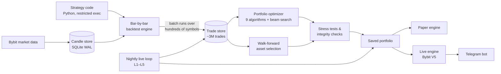

# The War Room

**Walk-forward optimization (WFO) and walk-forward asset selection (WFAS) for crypto perpetual futures, with a live engine that trades on Bybit. Built around one question: _is this backtest real, or did I fool myself?_**

The War Room takes a trading idea from code to a live exchange order. It backtests the idea across hundreds of Bybit perpetual-futures markets, then walk-forwards it (re-selects using only past data and scores the pick on data it never saw). It assembles portfolios, attacks the result with stress tests, and runs the survivors through a paper engine or Bybit's V5 API. Most of the engineering effort went into the parts that try to prove a result *wrong*.

> **Status:** a personal research platform, not a product. The live execution engine was validated in a structured 11-test campaign on Bybit mainnet with a ~$21 account (10 passed, 1 skipped); that campaign found and fixed 44 bugs. Strategies have only run on paper and in one small real-money trial; none has passed the validation gates for a real allocation. The gates exist to say "no", and so far they have.

---

## Why this project is interesting

Writing a backtester is easy. Making it hard to fool yourself with one is not. These are the problems I found most interesting and how the platform answers each.

| Problem | The War Room's answer |
|---|---|
| **A good backtest is usually overfitting.** Pick the best 5 of 500 assets in hindsight and any strategy looks great. | **Walk-forward asset selection.** Picks are made on an in-sample window and judged on the next, unseen window, rolled forward through history. Four time-window modes (three optimizer-driven, plus a hierarchical *Batch Selection* pipeline) and an *event-based* mode where the clock is measured in trades rather than days. |
| **Even out-of-sample results can be luck.** | **A calibration gate.** Before a strategy batch is trusted for the next window, it must also have worked in the *previous* window's out-of-sample period. That is a second, independent held-out check. |
| **"Too good to be true" assets dominate any ranking.** | **An overfit guard pipeline.** Log-diminishing, peer z-score penalty, Bayesian shrinkage toward the batch mean for low-trade-count assets, sigmoid cap, normal-range bonus. Each stage can be switched on or off independently, and with all of them off the result is byte-identical to a run without the guard. |
| **Is the exit logic actually better than random?** | **Adversarial stress tests.** A random-exit test keeps the real entries and randomises the exits, then compares the real profit factor against that distribution. A fat-tail bootstrap asks whether the strategy survives without its few biggest winners. Monte Carlo trade-sequence resampling estimates drawdown risk. A robustness scorecard grades each result A–F. |
| **Future data leaking into past decisions.** | **An IS/OOS integrity agent** with 14 check categories, a hard assertion that raises `OOSContaminationError`, trades still open at a selection's cutoff kept out of its score (clipped at the boundary or dropped until they close), and one boundary rule: in-sample is `<=` the cutoff, out-of-sample is `>`. |
| **Re-running years of backtests every night is too slow.** | **Resumable strategy state.** Each backtest snapshots every indicator buffer, persistent variable and open position at its last bar. The nightly job resumes from that snapshot and appends only the new trades. A test proves the resumed run produces the same fills as a cold run, field for field. |
| **Incremental systems drift silently.** | **A self-auditing parity canary.** Once a month the platform re-runs every active backtest from scratch and diffs it against the incrementally maintained store. It is audit-only: it never writes trades. |
| **The live engine must make the same decisions as the backtest.** | **A live↔backtest parity harness** drives the real live executor (warm-up, then bar-by-bar signal extraction) over the same candles as the backtester and compares every entry decision. On a 6-week holdout (2 portfolios, 10 symbols) the live engine reproduced **23/23** backtest entries. It also took one extra entry, which was traced to a state reset while flat. It is the gate before any exchange key reaches the server. |
| **Real exchanges are messy.** | **Fail-closed live engine.** Circuit breakers and daily loss limits. Refuses to start in Bybit hedge mode. SL placement is retried, and the position is closed at market if the stop cannot be placed. Lot sizes are floored with `Decimal`. Fill de-duplication is protected against time-of-check/time-of-use races. Restarts resume open positions and trailing stops. Paper and live trade histories are isolated. Heartbeat files feed a degraded-health endpoint, which the Telegram bot polls every 60 s and alerts on each state change. |
| **Translating TradingView strategies by hand is slow and a hand-written transpiler is brittle.** | **An LLM as the compiler front-end.** The original PineScript→Python transpiler was retired. The UI now wraps a strategy's PineScript in a ~600-line *translation contract* for an LLM: the engine's API and execution model, TradingView's exact indicator-smoothing rules, how to size warm-up for higher-timeframe indicators, and the rule that strategy state must stay JSON-serialisable so live warm-starts can restore it. The result is pasted back and validated by backtest. |
| **A 3-million-row trade store will accumulate garbage.** | **Forensic data hygiene.** A duplicate-trade bug was traced to a guard that had never been committed. The first cleanup script over-deleted legitimate partial exits. That was caught, the database was restored from its pre-cleanup backup, and the cleanup was rewritten: it now fingerprints each position and runs in a transaction whose invariant (*the canonical row count must not change*) rolls back on violation. It removed ~24k phantom rows across 13.6k positions. |

### Lessons from real money (the $21 mainnet campaign)

Some of the 44 bugs found while trading real (tiny) size on Bybit mainnet are good examples of what backtests never show:

- **Double entries after a WebSocket reconnect.** The candle aggregator fired "bar closed" twice during a reconnect race. Fixed with per-bar de-duplication plus an in-flight entry guard.
- **A position left without a stop.** A silent SL rejection left an open position unprotected. SL placement now retries three times, then flattens the position at market.
- **Missed fills.** Exchange callbacks were doing database work on the SDK's socket thread. That blocked its ping replies and caused disconnects. Callbacks are now handed off to the event loop, and a REST poll backs up the socket.
- **A 4-minute signal delay.** 5-minute bars were assembled from 1-minute candles, and a reconnect reset the counter. The engine now subscribes to the native timeframe stream, which marks the exact bar close.
- **Risk sizing that drifted with open P&L.** Position size used equity including unrealised P&L. It now uses a snapshot of realised wallet balance.

The full log is in [`LIVE_TEST_BYBIT.md`](LIVE_TEST_BYBIT.md).

---

## What it does



- **Data.** Downloads Bybit USDT-perpetual OHLCV for any symbol and timeframe. A bar-close-driven sync process wakes at each bar close, probes until the new candle exists, and pulls every active symbol in parallel.
- **Strategies.** A strategy is a Python class with a PineScript-like API (`init()` / `next()`, `entry()`, `exit()` with stop, limit and trail), written directly or translated from PineScript with the LLM contract above. Mother/daughter model: one code body, many named parameter sets. Strategy code runs through an AST-checked, restricted-builtins executor.
- **Backtesting.** Bar-by-bar engine. Orders fill at the next bar's open (or at the signal bar's close, as an option). Multiple concurrent positions, persistent SL/TP/trailing stops, partial exits, risk-based sizing, four streak-based sizing modes, and commission, slippage, spread and funding costs. Batch mode runs one strategy over hundreds of symbols.
- **Analysis.** 50+ portfolio KPIs and a 22-objective optimizer. Nine diversification algorithms: greedy, HRP, PCA clustering, quality-first, tournament, genetic, marginal-Sharpe, ensemble, walk-forward-validated. Also a 3-layer beam search over strategy batches, correlation analysis, session (time-of-day) analysis, Kelly allocation and the stress tests above.
- **Portfolios & live loop.** Saved portfolios are kept current by a scheduled pipeline. L1 extends trade stores, L2 rotates "hybrid" baskets, L3 files rebalance *proposals* at window boundaries (never auto-applied to non-hybrid portfolios), L4 is the parity canary and L5 is a weekly paper refresh.
- **Execution.** Paper engine and Bybit V5 live engine share one order-management path. A Telegram bot provides monitoring and confirmation-gated control: emergency stop, close-all, reset safety.

See **[ARCHITECTURE.md](ARCHITECTURE.md)** for how the pieces fit together, the design decisions, and the known limitations.

---

## Tech stack

| Layer | Choice | Why |
|---|---|---|
| API & engines | Python 3.13, FastAPI, SQLAlchemy 2, Pydantic v2 | The numeric stack (pandas, numpy, scipy, scikit-learn) and the official Bybit SDK (`pybit`) are Python. |
| Storage | SQLite in WAL mode | Single machine, several processes. WAL lets readers and one writer coexist without a database server. |
| Scheduling | APScheduler (background threads) | The asyncio scheduler silently dropped overnight jobs when the API's event loop was idle, so it was replaced. |
| UI | Next.js 15, React 19, TypeScript, Tailwind v4 | A typed dashboard: 14 pages, 200+ components. |
| Ops | Docker, file heartbeats, Telegram | Runs headless on a home server. Every long-running process reports liveness. |

**By the numbers:** ≈99k lines of Python across 45 API route modules and 33 database tables, ≈56k lines of tests (**4,500+ passing**), and ≈70k lines of TypeScript.

---

## Repository layout

```
backend/
  api/            FastAPI app + 45 route modules
  backtester/     bar-by-bar engine, strategy base class, indicators, metrics
  analysis/       optimizer, objectives, walk-forward engines, overfit guard,
                  stress tests, integrity agent, KPI suite
  exchange/       live engine: coordinator, executor, order/position managers,
                  safety monitor, trailing-stop tracker, WebSocket feeds, paper sim
  services/       nightly live loop (L1–L5), parity canary, live parity harness
  scanner/        signal scanner for active portfolios
  db/             ORM models + idempotent migrations
  tests/          pytest suite (in-memory SQLite fixtures)
frontend/         Next.js dashboard
telegram_bot/     mobile monitoring + control
candle_sync.py    bar-close-driven candle sync + signal scan (own process)
download_worker.py  download / refresh worker (own process, :8081)
```

---

## Running it

Requires Python 3.13 and Node 20+.

```bash
# backend
pip install -r backend/requirements.txt
cp backend/config/.env.example backend/config/.env   # optional: exchange keys, Telegram, API key
python -m backend.main                               # API on http://127.0.0.1:8055

# workers (separate terminals)
python download_worker.py                            # downloads + refreshes, :8081
python candle_sync.py                                # candle sync + signal scanner

# frontend
cd frontend && npm install && npx next dev -p 3033   # http://localhost:3033
```

Without exchange keys you can still download public market data, backtest, analyse and paper-trade. In production the same processes run as five Docker containers (live backend, paper backend, worker, candle sync, frontend) built from two images and sharing one data volume; see `Dockerfile` and `frontend/Dockerfile`.

## Tests

```bash
pip install -r requirements-dev.txt
python -m pytest backend/tests -q
```

Tests use in-memory SQLite fixtures, and `backend/tests/conftest.py` points the app's database, heartbeat files, log and auto-saved optimizer runs at a temporary folder, so a test run never touches real data. It covers hand-computed reference values for every scoring metric, IS/OOS boundary integrity, optimizer parity between the vectorised and reference paths, Bybit V5 contract tests, resume-from-snapshot parity, and the live loop's safety contracts (for example, *a non-hybrid portfolio's basket is byte-identical after the nightly refresh*).

---

## How it was built

I designed the system, wrote the specifications and owned verification. Implementation was done largely with AI coding agents (mainly Claude Code; also Gemini and Devin) under a test-first, audit-heavy workflow. Changes ship with tests, audit fixes are pinned by regression tests (`test_cs001…071`, `test_audit_*`), and parity checks run continuously. Directing that process is the skill this project exercised most: turning a domain question into precise specs, and building verification strong enough to trust code I did not type.

## Known limitations

Documented in detail in [ARCHITECTURE.md § Known limitations](ARCHITECTURE.md#known-limitations). In short:

- Intrabar order of fills is unknown from OHLC bars. The engine checks stops before targets (conservative), but trailing stops assume the bar's extreme came first.
- The strategy executor blocks dangerous imports and builtins. That stops accidents, not a determined attacker. Only run strategy code you trust.
- Single-machine design (SQLite). The API binds to localhost by default; API-key authentication is optional and off unless `SECRET_KEY` is set.
- The backend is the tested half. The frontend type-checks with ~350 errors (mostly response interfaces that lag the API), and its production build skips type-checking.

## License

Copyright © 2026 [vandenhovemax](https://github.com/vandenhovemax). **All rights reserved.** The code is published to be read and reviewed; it may not be used, copied, modified or distributed without written permission. See [`LICENSE`](LICENSE).
